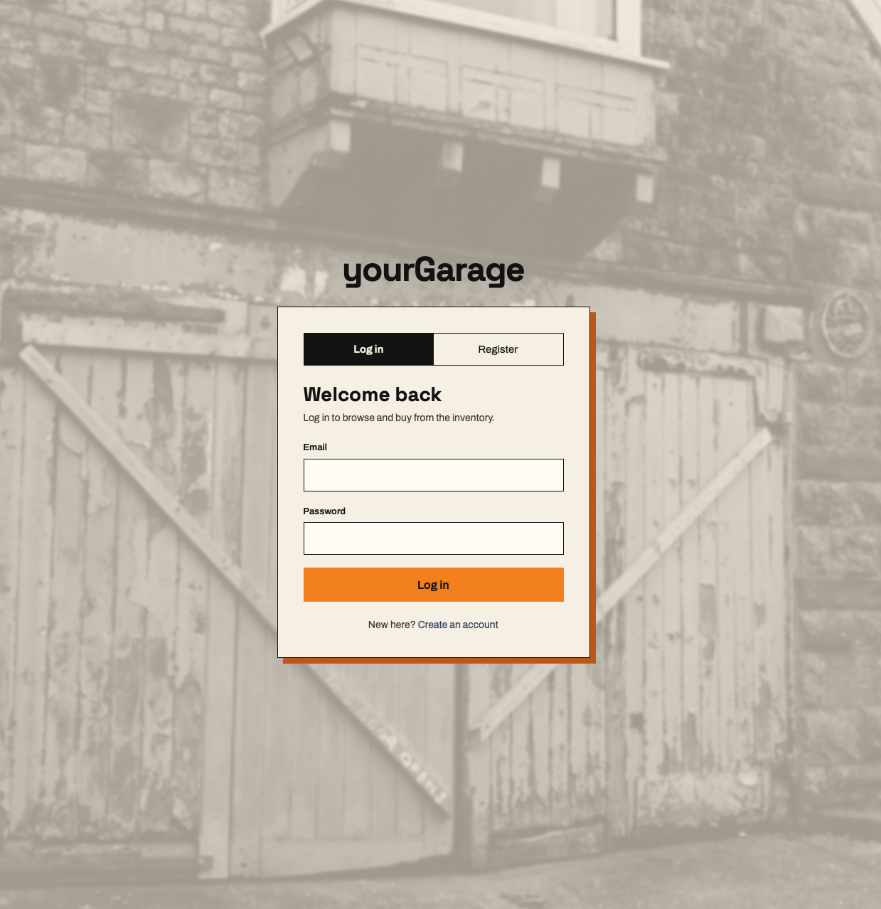
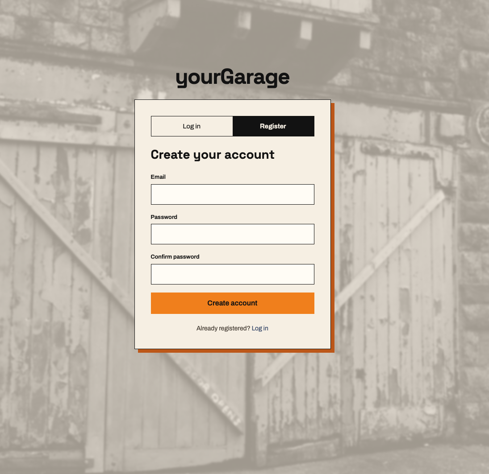
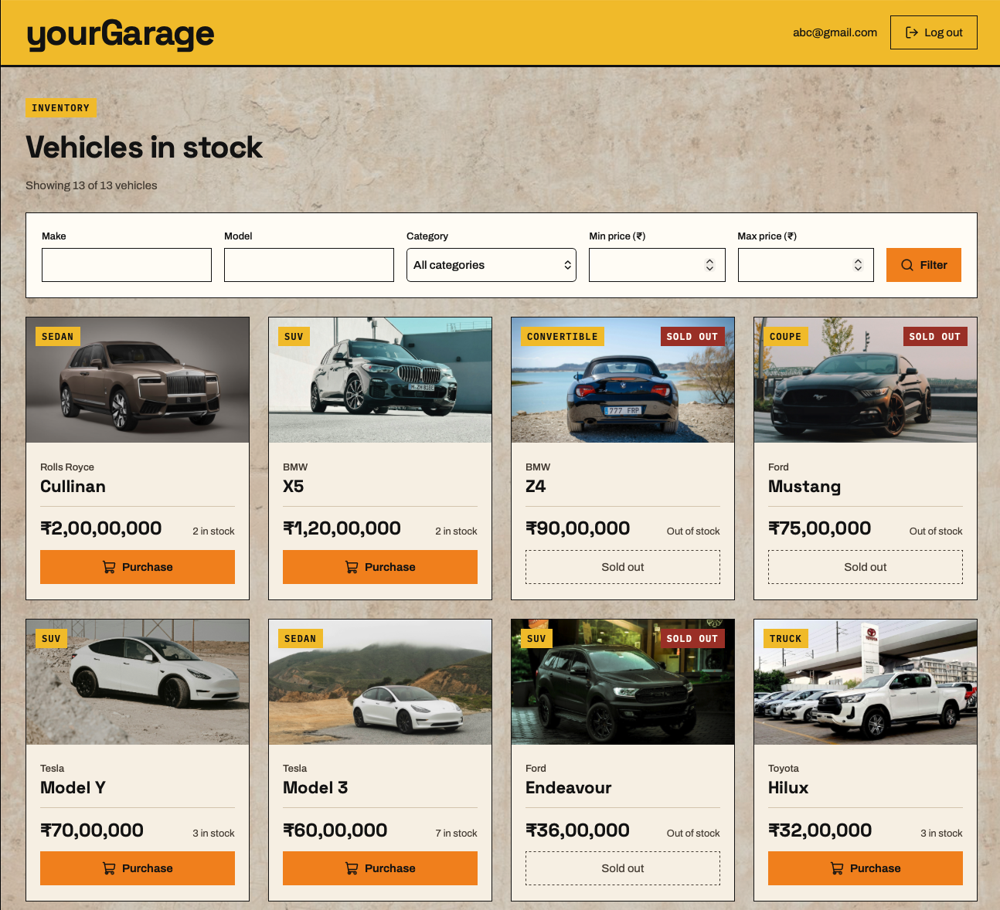
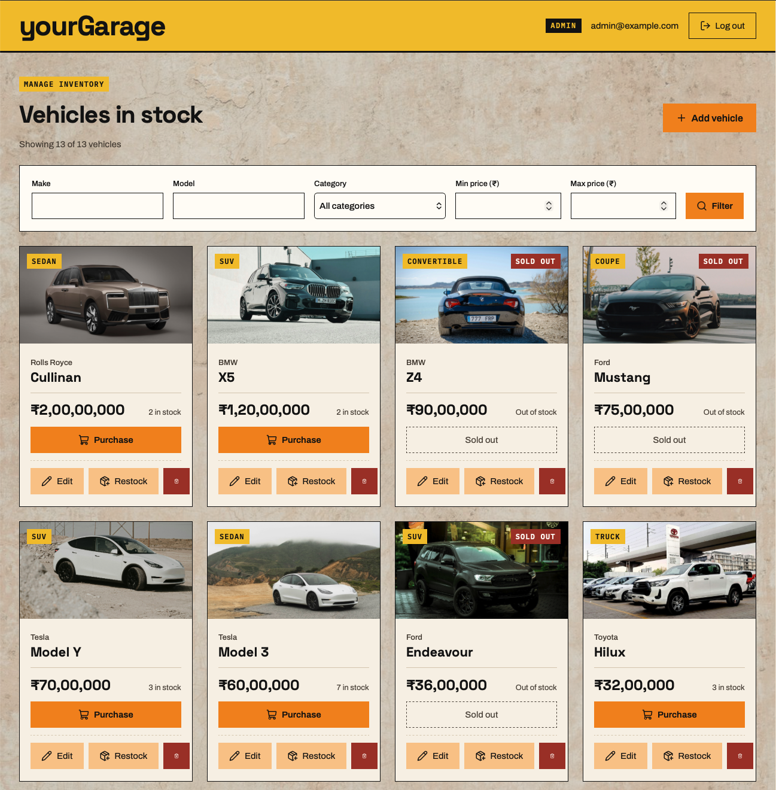
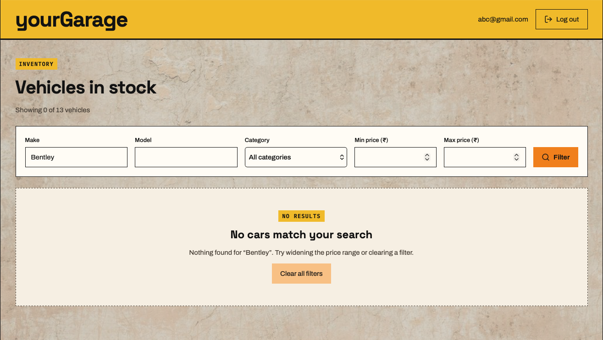
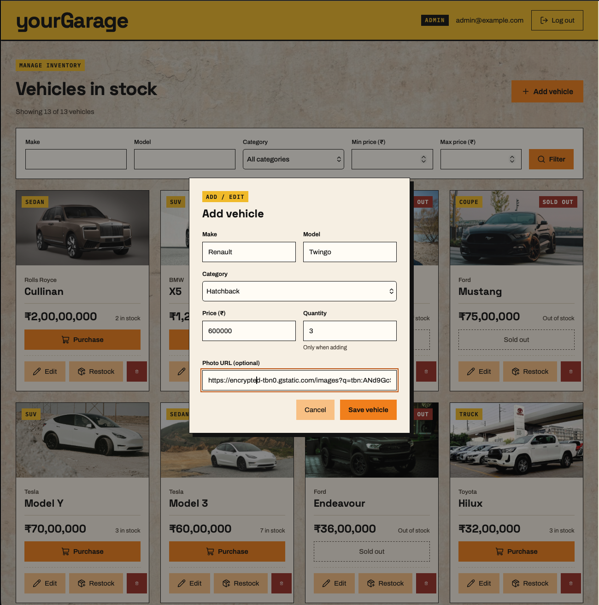
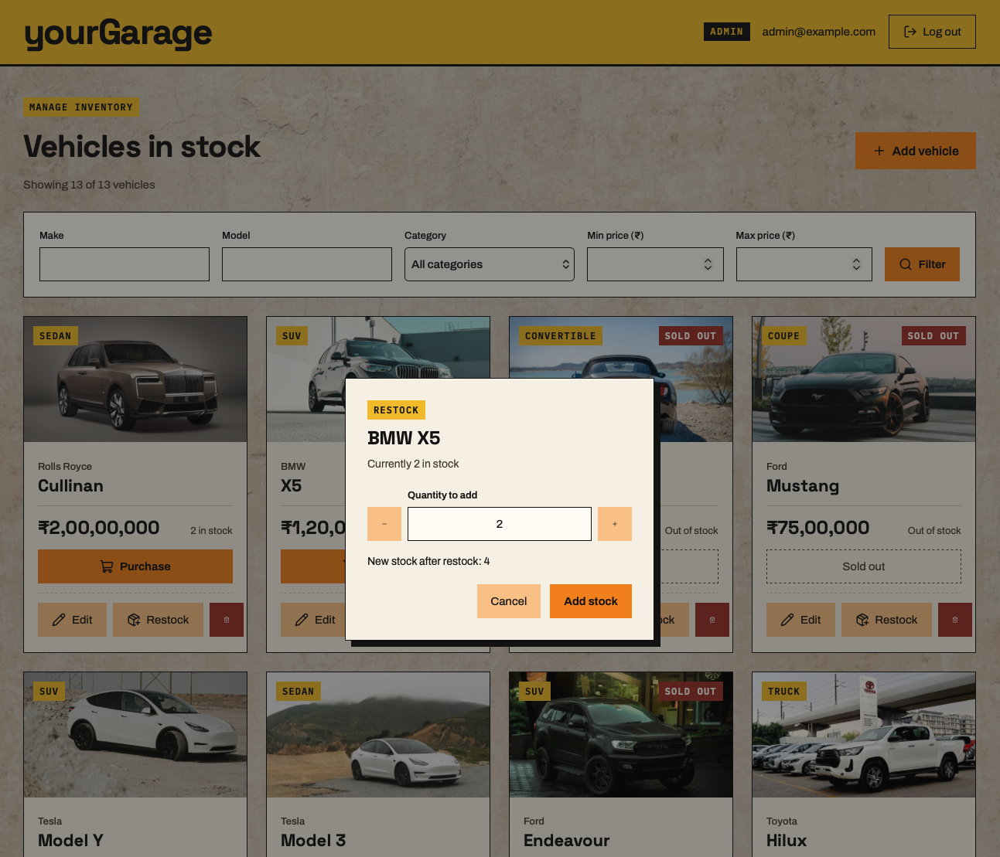
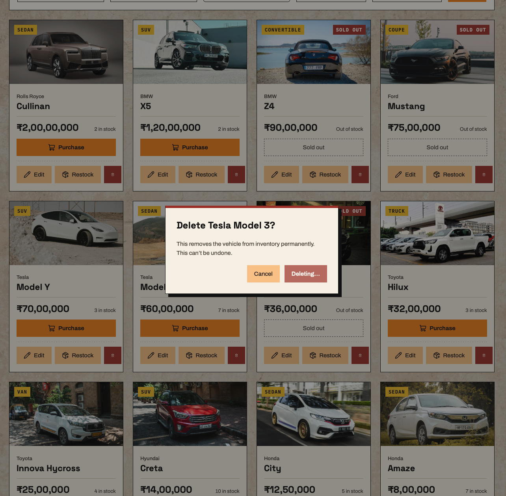

# yourGarage — Car Dealership Inventory System by Utkarsh Prithviraj

A full-stack inventory app for a car dealership, built test-first (TDD). Everyone can log in, browse, search and buy cars; admins can also add, edit, restock and delete vehicles. Prices are in Indian rupees (₹, Indian digit grouping).

**Live demo:** https://your-garage-utkarsh-v2.vercel.app

## Features

- **Accounts:** register and log in (JWT, 1-hour expiry). Registration always creates a normal user; the admin comes from a seed script.
- **Dashboard:** every vehicle with photo (or a placeholder if missing or broken), category, rupee price and stock. Sold-out cars show a disabled "Sold out" button; the last unit shows "Only 1 left".
- **Search and filter:** make, model, category and price range, combined; "Showing X of Y vehicles", a no-results state and "Clear all filters".
- **Purchase:** buys one unit; stock check and decrease happen in one database update, so stock can never go below zero, even with simultaneous buyers.
- **Admin:** add vehicles (with optional photo URL), edit (only changed fields are sent), restock with a −/+ stepper and preview, delete with confirmation.
- **Clear errors:** every API error is JSON `{ "error": "message" }` and is shown in the UI.

## Tech stack

| Part | Tools |
|---|---|
| Backend | Node 22, TypeScript, Express 5, Prisma 7, PostgreSQL 16, zod, jsonwebtoken, bcrypt |
| Backend tests | Jest + Supertest against a separate `dealership_test` database |
| Frontend | Vite 8, React 19, TypeScript, React Router, Tailwind CSS 4 (custom design tokens), lucide-react icons |
| Frontend tests | Vitest + React Testing Library (jsdom), API faked per test |
| Database locally | Docker Compose (`postgres:16`) |

## API

All vehicle endpoints need a `Authorization: Bearer <token>` header.

| Method | Path | Who |
|---|---|---|
| POST | `/api/auth/register` | anyone |
| POST | `/api/auth/login` | anyone |
| GET | `/api/vehicles` | logged in |
| GET | `/api/vehicles/search?q=&make=&model=&category=&minPrice=&maxPrice=` | logged in |
| POST | `/api/vehicles/:id/purchase` | logged in |
| POST | `/api/vehicles` | admin |
| PUT | `/api/vehicles/:id` | admin |
| DELETE | `/api/vehicles/:id` | admin |
| POST | `/api/vehicles/:id/restock` | admin |

## Setup

You need **Node 22**, **npm** and **Docker Desktop**.

### 1. Clone and start the database

```
git clone https://github.com/Zekrom0506/car-dealership-inventory.git
```
```
cd car-dealership-inventory
```
```
docker compose up -d
```

This starts PostgreSQL 16 on port 5432 and creates two databases: `dealership_dev` (the app) and `dealership_test` (the test suite).

### 2. Backend

```
cd backend
```
```
npm install
```

Create the environment files from the examples, then open `.env` and set your own `JWT_SECRET`, `ADMIN_EMAIL` and `ADMIN_PASSWORD` (at least 8 characters):
```
cp .env.example .env
```
```
cp .env.test.example .env.test
```

Create the tables, then add the admin account and 12 sample cars:
```
npm run db:migrate
```
```
npm run db:seed
```

Start the API on http://localhost:4000 (leave it running):
```
npm run dev
```

### 3. Frontend

In a second terminal, from the project folder:
```
cd frontend
```
```
npm install
```
```
npm run dev
```

Open http://localhost:5173 and log in with the `ADMIN_EMAIL` / `ADMIN_PASSWORD` from `backend/.env`, or register a new user. The Vite dev server forwards `/api` to the backend, so no CORS setup is needed locally.

Sample car photos are in `frontend/public/cars/`, named `<make>-<model>.jpg` (e.g. `honda-city.jpg`).

### 4. Running the tests

Backend (needs the Docker database running; migrations are applied to `dealership_test` automatically):
```
cd backend
```
```
npm test
```
```
npm run test:coverage
```

Frontend (no database or backend needed):
```
cd frontend
```
```
npm test
```
```
npm run test:coverage
```

## Deployment

Three free services: **Neon** (PostgreSQL), **Render** (API) and **Vercel** (frontend).

| Service | Setting | Value |
|---|---|---|
| Neon | `DATABASE_URL` | the direct (non-pooled) connection string, ending in `?sslmode=require` |
| Render | Root directory | `backend` |
| Render | Build command | `npm install --include=dev && npx prisma generate && npx prisma migrate deploy && npm run build` |
| Render | Start command | `npm start` |
| Render | Health check path | `/api/health` |
| Render | Environment | `DATABASE_URL`, `JWT_SECRET` (long random string), `JWT_EXPIRES_IN=1h`, `FRONTEND_ORIGIN` (the Vercel URL, no trailing path), `ADMIN_EMAIL`, `ADMIN_PASSWORD`, `NODE_VERSION=22` (Render supplies `PORT` itself) |
| Vercel | Root directory | `frontend` |
| Vercel | Build command / output | `npm run build` / `dist` |
| Vercel | Environment | `VITE_API_URL` = the Render URL (e.g. `https://your-api.onrender.com`) |

- The API only accepts browser requests from the origin(s) in `FRONTEND_ORIGIN` (CORS). Several origins can be comma-separated.
- `frontend/vercel.json` sends every path to `index.html`, so pages like `/login` also work on refresh.
- Create the admin and sample cars once, from your own computer, after the first Render deploy (migrations run during the build):

```
cd backend
```
```
DATABASE_URL='<Neon connection string>' ADMIN_EMAIL='<your email>' ADMIN_PASSWORD='<strong password>' npm run db:seed
```

## Test reports

| Part | Tests | Statements | Branches | Functions | Lines | Report |
|---|---|---|---|---|---|---|
| Backend | 218 passed | 98.34% | 94.44% | 95.23% | 98.28% | [docs/test-report-backend.md](docs/test-report-backend.md) |
| Frontend | 122 passed | 96.77% | 88.74% | 97.88% | 98.93% | [docs/test-report-frontend.md](docs/test-report-frontend.md) |

## Screenshots

<!-- TODO: add screenshots -->
| Screen | Image |
|---|---|
| Log in |  |
| Register |  |
| Dashboard (user) |  |
| Dashboard (admin) |  |
| Search with no results |  |
| Add / edit vehicle |  |
| Restock |  |
| Delete confirmation |  |

## Known limitations

- **Login token in `localStorage`.** It keeps you logged in after a refresh, but any script on the page could read it, so an XSS bug could steal it. A safer option is an httpOnly, Secure, SameSite cookie set by the backend (needs CSRF protection). Expired tokens are dropped on load, and the server checks the token on every request.
- **No downward stock correction.** Quantity can't be changed through edit, and restock only adds. If a stock-take finds fewer cars, an admin can only lower stock by "purchasing" the extra units. A future fix: an admin-only relative adjustment (e.g. `{ "change": -2 }`) that refuses to go below zero.
- **Mobile search and filter controls are not built yet.** The design's mobile search box, category chips and Filter panel aren't done; on small screens the desktop filter form is shown instead. The mobile account menu is also not done (the header shows Log out directly).
- **Dialogs close only with Cancel.** Esc-to-close and keeping keyboard focus inside dialogs are not done yet.
- **Free hosting is slow to wake.** Render's free plan puts the API to sleep when idle, so the first request after a break can take about a minute.
- **Uncovered lines.** A few lines are not covered by tests, mostly defensive code (e.g. fallback error messages, "already submitting" guards). Each one is listed with the reason in the test reports. One real frontend gap: no test types into the Model filter.
- **Git history quirk.** Commit `ef061b5` (a refactor) also contains a change to clearer error messages, so the earlier `[RED]` commit `1ad14e6` did not actually fail.

## My AI Usage

### Tools
- **Claude, two build chats.** The first planned the stack, schema and build order, then built the backend. The second built the frontend and prepared deployment. Both used strict Red-Green-Refactor: a failing test first, then the smallest code to pass, then a refactor. `CLAUDE.md` carried the plan, rules and decisions from one chat to the next.
- **Claude Design** for the look of the frontend. I exported the design and had Claude turn it into Tailwind tokens.
- **A separate Claude chat as a prompt coach,** to structure my thoughts and catch errors. I edited its suggestions before sending them to the build chats.

Claude ran the tests in its own sandbox, and I re-ran them on my Mac before committing. I did the Neon, Render and Vercel setup and made every commit myself. Tests added for code that already worked are tagged `[COVERAGE]`, and I broke the code temporarily to prove they could fail.

### Key decisions
- **No overselling.** A purchase checks and lowers stock in one conditional `UPDATE … WHERE quantity >= n`, tested with parallel buyers. Database `CHECK` constraints stop stock going negative even if the code is wrong.
- **Stock is locked out of edits.** `PUT` rejects `quantity`, so an admin saving an edit can't overwrite a sale that happened meanwhile. Restock only adds, and I documented the missing downward correction as a known limitation.
- **The role comes from the database on every request, not from the token,** so a demoted admin loses access immediately.
- **Login gives the same error for an unknown email and a wrong password,** so it doesn't reveal which emails are registered.
- **Every error is JSON,** including malformed bodies, unknown routes and unexpected 500s, with no stack traces sent to the client.
- **Strict input limits:** prices are whole rupees within PostgreSQL's integer range, IDs are validated (so `/search` is never read as an ID), and image URLs reject `javascript:` and links to other sites.
- **Search uses a backend `q` parameter,** built test-first, instead of filtering in the browser.
- **Deployment:** the API accepts browser requests only from the frontend address set in `FRONTEND_ORIGIN`.

### Mistakes that were caught
- **Whole-folder `git add`.** `git add backend/src` pulled a message change into a refactor commit, so the test in `1ad14e6` never actually failed. I left the history as it is and have used exact file paths since.
- **Skipped RED output.** For the "Out of stock" message, Claude went straight to GREEN. I objected, and "always show the failing output" became a rule in `CLAUDE.md`.
- **Tests that couldn't fail.** The `isAdmin` test passed against a stub because "not admin" contains "admin". A search test using `q=o` passed while `q` was still ignored, because every car contains an "o". Both now check exact results.
- **Missing browser preflight.** My CORS spec only checked response headers. Because the frontend sends an `Authorization` header, browsers first send an `OPTIONS` request, which Express was answering with a 200 and no CORS headers. A test for it was added before the code.
- **Wrong environment assumptions.** Claude tried to check Docker from its sandbox, which is separate from my Mac, and switched to an embedded Postgres 16. Prisma 7 didn't regenerate its client after a migrate, so `db:migrate` now runs `generate` too.
- **Unpushed commits.** My first deployment failed because the CORS and API-address commits were still only on my Mac. Render and Vercel had built the old code.

### Reflection
AI was fast at code and especially at edge-case tests: race conditions, ID limits, malformed JSON. It was weakest at reporting what had actually happened with files, commits and test output, and twice it said work was done when it wasn't. Insisting on seeing the failing output and re-running everything on my Mac caught most problems. Next time I would push after every commit and test the deployed site earlier. Every commit that used AI carries the co-author trailer.

The full conversations are linked in [PROMPTS.md](PROMPTS.md).
